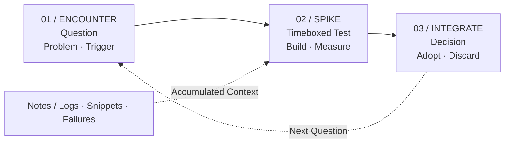

##### Learning · Experiment · Engineering

도구의 수명이 짧아진 환경에서, 지식을 쌓는 대신 검증하는 방식으로 학습을 다시 설계한 기록.

---

예전에는 하나의 기술을 깊게 익히면 몇 년은 쓸 수 있었지만, 지금은 문서를 다 읽기도 전에 다음 버전이 나오고, 어제 정리한 베스트 프랙티스가 오늘 바뀌어 있는 일이 반복됩니다. 그래서 "무엇을 배울 것인가"보다 "어떻게 배우는 구조를 만들 것인가"를 먼저 고민하게 되었습니다.

>  빠르게 변하는 환경에서 중요한 질문은 "이 기술을 다 아는가?"보다 **"이 기술이 내 문제를 푸는지 얼마나 빨리 확인할 수 있는가?"** 입니다.

## 01. 문제 정의

새로운 기술을 학습하는데 병목 지점은 대부분 정보의 부족이 아니라 판단의 지연이었습니다. 읽을 자료는 충분한데, 그중 무엇이 지금 필요한지 가리지 못해 시간이 흩어집니다.

- **유효기간:** 지금 배우는 내용은 언제까지 유효한가?
- **적용 거리:** 내가 가진 문제와 이 기술 사이의 거리는 얼마나 되는가?
- **검증 비용:** 쓸모를 확인하는 데 하루가 드는가, 2주가 드는가?
- **폐기 가능성:** 아니라고 판단했을 때 미련 없이 버릴 수 있는가?

## 02. 학습 루프 설계

선형적인 완독 대신 짧은 순환 구조를 가정했습니다. 자료를 끝까지 읽고 적용하는 것이 아니라, 작은 질문을 만들고 즉시 실험한 뒤 결과를 남기는 흐름입니다.



*Fig. 001 / Learning Loop*

이 구조의 핵심은 세 번째 단계에서 **버리는 선택도 결과로 기록한다**는 점입니다. 적용하지 않기로 한 판단과 그 이유가 남아야, 같은 기술을 다시 마주쳤을 때 처음부터 검토하지 않습니다.

## 03. 실험 기록 방식

아래는 실제 운영 중인 스키마가 아닌, 스파이크 단위를 어떻게 기록하는지 보여주는 예시입니다.

```yaml
# spike.yaml (example)
question: "이 런타임이 현재 빌드 시간을 줄여주는가?"
timebox: 4h
hypothesis: "콜드 스타트가 절반 이하로 줄어든다"

measured:
  before: "12.4s"
  after: "9.8s"

decision: discard
reason: "개선 폭이 마이그레이션 비용을 넘지 못함"
revisit_when: "번들 크기가 2배가 되면 재검토"
```

시간을 정해두지 않으면 흥미로운 기술일수록 검증이 아니라 탐닉으로 넘어가기 쉽기 때문에 타임박스를 먼저 적어보는 것이 중요했습니다.

## 04. 주요 원칙

| 원칙 | 내용 |
|---|---|
| **Question First** | 자료부터 열지 않고, 답하려는 질문을 한 문장으로 먼저 적습니다. |
| **Timeboxed Spike** | 모든 실험에 상한 시간을 둬서 탐색이 무한히 늘어나지 않게 합니다. |
| **Discard Log** | 채택하지 않은 기술도 이유와 함께 남겨 재검토 비용을 줄입니다. |
| **Build to Learn** | 읽어서 이해한 것과 만들어서 확인한 것을 구분해 기록합니다. |

## 05. 배운 점

모든 기술을 따라가는 것은 불가능하고, 사실 필요하지도 않았습니다. 대신 새로운 것이 등장했을 때 빠르게 판단할 수 있는 상태를 유지하는 쪽이 훨씬 오래 쓸모가 있었습니다.

결국 학습의 경쟁력은 아는 양이 아니라, 모르는 것을 마주했을 때 결론까지 가는 속도에 달려 있습니다.

---

## Related Notes

- [AI Agent를 실제 서비스에 적용하며 고민한 것들](ai-agent-service.md)
- [아이디어를 실제 디지털 제품으로 만드는 과정](idea-to-product.md)
