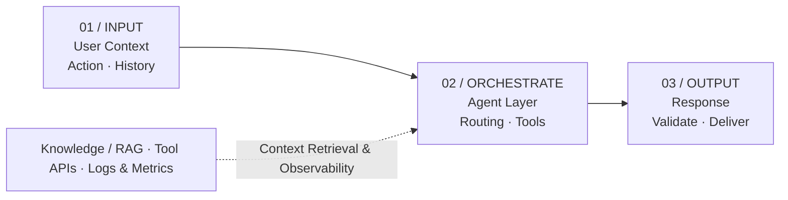

##### AI Agent · Architecture · Product

LLM을 연결하는 것에서 끝나지 않고, 안정적으로 동작하는 AI 제품을 만들기 위해 고려해야 할 설계 원칙과 구현 과정 설명

---

AI 기능을 프로토타입으로 만드는 일과 실제 사용자가 반복적으로 이용하는 서비스로 운영하는 일은 큰 차이가 있는데요. 특히, 응답 품질뿐 아니라 처리 시간, 실패 상황, 비용, 사용자 경험을 함께 설계해야 하기 때문에 많은 고민이 필요합니다.

>  AI Agent를 제품에 적용할 때 가장 중요한 질문은 "어떤 모델을 사용할 것인가?"보다 **"어떤 상황에서 AI가 개입해야 하는가?"** 입니다. 

<!-- ## 목차

1. [문제 정의](#01-문제-정의)
2. [아키텍처 설계](#02-아키텍처-설계)
3. [구현 접근](#03-구현-접근)
4. [주요 설계 결정](#04-주요-설계-결정)
5. [배운 점](#05-배운-점) -->

## 01. 문제 정의

사용자는 AI가 어떤 기술로 동작하는지보다, 자신의 문제를 얼마나 자연스럽게 해결하는지에 관심이 있습니다. 따라서 처음부터 범용 대화형 Agent를 만들기보다, 서비스 안에서 AI가 수행해야 할 역할과 책임을 구분했습니다.

- **맥락:** 현재 사용자가 무엇을 하고 있는가?
- **개입:** AI의 도움이 필요한 순간은 언제인가?
- **검증:** AI의 출력이 신뢰할 만한지 어떻게 판단할 것인가?
- **복구:** 응답이 실패하면 사용자 경험을 어떻게 유지할 것인가?

## 02. 아키텍처 설계

Agent를 독립적인 기능으로 분리하고, 서비스의 기존 업무 로직과 연결하는 구조를 가정했습니다. 요청을 바로 LLM으로 보내는 대신 입력 맥락을 정리하고 결과를 검증하는 계층을 둡니다.



*Fig. 001 / Agent System Architecture*

이 구조에서는 Agent가 모든 판단을 독점하지 않습니다. 중요한 비즈니스 규칙은 기존 서비스 계층에 남기고, AI는 맥락 해석과 제안 생성처럼 유연성이 필요한 작업을 담당합니다.

## 03. 구현 접근

아래 코드는 실제 프로덕션 코드가 아닌, 컨텍스트 구성과 응답 검증 흐름을 보여주는 Python 예시입니다.

```python
# agent_service.py (example)
async def run_agent(user_input, context):
    request = {
        "message": user_input,
        "context": context,
        "tools": allowed_tools(context),
    }

    result = await agent.generate(request)

    if not validate_response(result):
        return fallback_response()

    return format_for_user(result)
```

실제 구현에서는 타임아웃, 재시도 정책, 개인정보 처리, 도구 호출 권한, 평가 데이터셋 등을 추가로 고려해야 합니다.

## 04. 주요 설계 결정

| 결정 | 내용 |
|---|---|
| **Context First** | 질문만 전달하지 않고 사용자 행동과 서비스 상태를 함께 고려합니다. |
| **Bounded Tools** | Agent가 사용할 수 있는 도구와 권한을 명시적으로 제한합니다. |
| **Fallback UX** | 모델 응답이 늦거나 실패해도 기본 기능을 계속 사용할 수 있게 설계합니다. |
| **Evaluation** | 정답률뿐 아니라 응답 시간, 비용, 사용자 만족도와 개입 적절성을 함께 살펴봅니다. |

## 05. 배운 점

좋은 AI 제품은 AI 기능이 눈에 많이 띄는 제품이 아닐 수 있습니다. 사용자가 문제를 해결하는 흐름을 방해하지 않으면서 필요한 순간에 적절한 도움을 제공하는 것이 더 중요합니다.

결국 AI Agent의 설계는 모델 성능의 문제인 동시에 제품 설계, 시스템 아키텍처, 사용자 경험의 문제입니다.

---

## Related Notes

- [확장 가능한 클라우드 아키텍처 설계하기](cloud-architecture.md)
- [데이터 파이프라인을 설계하는 방법](data-pipeline.md)
