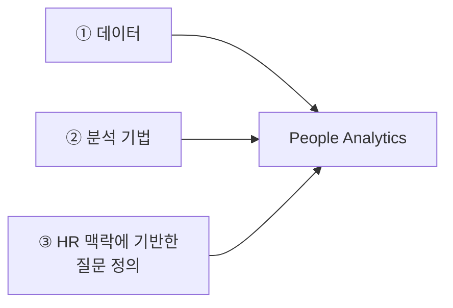

## Lecture 01. HR 데이터 분석 과정 오리엔테이션

HR 데이터 분석 과정의 첫 수업 정리입니다. 현업의 HR 문제를 **분석 가능한 질문으로 바꾸는 법**을 배우는 것이 전체 과정의 목표이고, 채용·성과·보상·몰입·이직·조직문화를 테마별로 다룹니다.

## 1. 학습 목표

| | 목표 |
|---|---|
| 1 | 현업의 질문을 **분석 가능한 질문**으로 정의하기 |
| 2 | 여러 분석 방법론 중 문제에 적합한 방법 선택하기 |
| 3 | 생성형 AI를 활용해 R로 데이터 분석 수행하기 |
| 4 | 분석 결과로부터 실질적인 인사이트 도출하기 |
| 5 | 생성형 AI 사용 시 개인정보 보호 등 **윤리적 쟁점 준수하기** |

5번이 가장 중요하다고 강조되었습니다.

## 2. 수업 방식 — R을 가르치지 않고 AI로 R을 쓰는 법을 가르친다

수강생 대부분이 R 경험이 없다는 전제에서 출발합니다. 이 수업은 **R 문법 자체를 가르치지 않습니다.** 대신 생성형 AI에게 필요한 R 코드를 생성시키고, 그것을 실행해 분석을 수행하는 방법을 가르칩니다.

현업 실무자가 Mplus나 SPSS 같은 통계 프로그램을 따로 배우기 어려운 현실을 고려한 접근입니다.

> 분석 개념이 동일하므로 과제 수행 시 R 대신 **Python을 써도 무방**합니다.

## 3. 주차별 운영 계획

| 주차 | 테마 | 분석 기법 |
|---|---|---|
| 1 | 오리엔테이션 · 인재 선발 | t-test 등 기초 분석 |
| 2 | 인재 선발 심화 · 성과 관리 | 로지스틱 회귀 분석 |
| 3 | 보상 관리 | |
| 4 | 직원 몰입 | |
| 5 | 이직 관리 | |
| 6 | 조직 문화 | |
| 최종 | 기말 과제 발표 | 각자의 HR 문제 분석 계획 공유 |

주차가 올라갈수록 분석 기법이 점진적으로 심화되는 구조입니다.

## 4. 평가와 과제

- **성적**: 절대평가. 총 6회 중 **3회 이상 결석 시 F**
- **수시 과제**: 총 5회. 수업 실습을 복습하고 결과 파일 제출. 오류가 나면 **먼저 생성형 AI에 질문**해보고, 해결되지 않으면 다음 수업에 질문
- **중간 과제**: 각 주제 관련 논문 한 편을 선정해 10분 내외로 발표
- **기말 과제**: 자신의 실제 HR 문제를 정의하고, 분석할 데이터와 방법을 설계해 발표

## 5. People Analytics란

> **데이터, 기법, 기술을 활용해 인적 자원 관련 의사결정을 지원하는 접근 방식**

성공적인 People Analytics에는 세 가지 기둥이 필요합니다.

**세 번째가 가장 중요합니다.** 데이터와 기법이 있어도 질문이 잘못 정의되면 분석 결과는 쓸모가 없습니다. 예시로 제시된 질문은 *"신입사원 인적성 검사가 고성과자를 예측하는가?"* 였습니다.

## 6. 데이터 보안 — 가장 강조된 부분

- 이름, 학번 등 **개인 식별 정보**나 회사의 민감 데이터를 **절대 생성형 AI에 입력하지 말 것**
- AI가 생성한 분석 결과라도 **반드시 사람이 직접 검증**하는 과정을 거칠 것

## 7. 사전 준비

- **R**과 **RStudio Desktop** 설치
- 원활한 실습을 위해 생성형 AI 유료 계정 준비 권장 (GPT Plus 월 29,000원 수준 또는 Claude 유료 버전)

---

## Related Notes

- [Lecture 02. 신뢰도·타당도와 통계적 유의성 검증](hr-lecture02-statistics.md)
- [HR Analytics](index.md)
