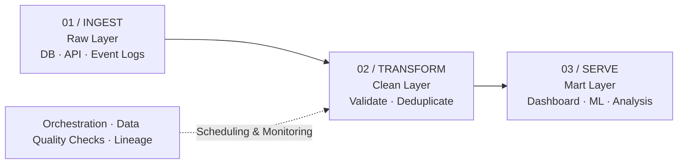

##### Data Pipeline · Data Engineering · Architecture

데이터를 옮기는 것에서 끝나지 않고, 믿고 쓸 수 있는 데이터를 꾸준히 만들어 내기 위한 파이프라인 설계 원칙과 구현 과정

---

한 번 데이터를 옮기는 스크립트와 매일 반복해서 실행되는 파이프라인은 다릅니다. 원천 데이터의 형식이 바뀌거나, 작업이 중간에 실패하거나, 같은 데이터가 두 번 들어오는 상황을 모두 견뎌야 하기 때문입니다.

> 데이터 파이프라인을 설계할 때 가장 중요한 질문은 "어떤 도구를 사용할 것인가?"보다 "이 데이터를 누가, 언제, 얼마나 믿고 쓰는가?" 였습니다. 

## 목차

1. [문제 정의](#01-문제-정의)
2. [아키텍처 설계](#02-아키텍처-설계)
3. [구현 접근](#03-구현-접근)
4. [주요 설계 결정](#04-주요-설계-결정)
5. [배운 점](#05-배운-점)

## 01. 문제 정의

데이터를 쓰는 사람은 파이프라인이 어떻게 생겼는지보다, 대시보드의 숫자를 믿을 수 있는지에 관심이 있습니다. 따라서 처음부터 모든 데이터를 모으기보다, 데이터가 어디서 와서 어디에 쓰이는지와 그 과정에서 지켜야 할 기준을 먼저 정했습니다.

- **수집:** 데이터는 어디서, 얼마나 자주 들어오는가?
- **품질:** 잘못된 데이터를 어느 단계에서 걸러낼 것인가?
- **재처리:** 작업이 실패하거나 로직이 바뀌면 과거 데이터를 다시 만들 수 있는가?
- **활용:** 분석가, 대시보드, ML 모델은 각각 어떤 형태의 데이터가 필요한가?

## 02. 아키텍처 설계

원천 데이터를 그대로 보관하는 계층과, 정제하고 가공한 데이터를 제공하는 계층을 나누는 구조를 가정했습니다. 원본을 남겨 두면 변환 로직이 바뀌어도 언제든 처음부터 다시 만들 수 있습니다.



*Fig. 003 / Data Pipeline Architecture*

이 구조에서는 각 계층이 맡은 역할이 분명합니다. 원천 계층은 손대지 않은 기록을 보관하고, 정제 계층은 품질 기준을 적용하며, 활용 계층은 쓰는 사람에 맞춘 형태로 데이터를 제공합니다.

## 03. 구현 접근

아래 코드는 실제 프로덕션 코드가 아닌, 날짜 단위로 데이터를 다시 만들 수 있게 설계한 변환 작업을 보여주는 Python 예시입니다.

```python
# daily_orders_job.py (example)
def run_daily_orders(target_date):
    raw = read_raw("orders", date=target_date)

    cleaned = (
        raw.drop_duplicates(subset=["order_id"])
           .query("amount >= 0")
    )

    if not check_quality(cleaned, min_rows=1, required=["order_id", "user_id"]):
        raise DataQualityError(f"orders {target_date} failed quality check")

    # 같은 날짜를 다시 실행해도 결과가 같도록 해당 파티션을 덮어씁니다.
    overwrite_partition("mart.daily_orders", date=target_date, data=cleaned)
```

실제 구현에서는 스키마 변경 감지, 늦게 도착하는 데이터 처리, 개인정보 마스킹, 작업 간 의존성 관리, 실패 알림 등을 추가로 고려해야 합니다.

## 04. 주요 설계 결정

| 결정 | 내용 |
|---|---|
| **Keep Raw Data** | 원천 데이터는 가공하지 않고 보관해, 변환 로직이 바뀌어도 다시 만들 수 있게 합니다. |
| **Idempotent Jobs** | 같은 작업을 여러 번 실행해도 결과가 같도록 파티션 단위로 덮어씁니다. |
| **Quality Gates** | 데이터 품질 검사를 통과하지 못하면 다음 단계로 넘기지 않습니다. |
| **Lineage** | 각 데이터가 어떤 원천과 변환을 거쳐 만들어졌는지 추적할 수 있게 기록합니다. |

## 05. 배운 점

좋은 데이터 파이프라인은 많은 데이터를 빠르게 옮기는 파이프라인이 아닐 수 있습니다. 데이터를 쓰는 사람이 의심 없이 숫자를 믿을 수 있도록, 문제가 생겼을 때 빨리 알아채고 다시 복구할 수 있는 것이 더 중요합니다.

결국 데이터 파이프라인의 설계는 기술 스택의 문제인 동시에 데이터 품질, 운영 절차, 데이터를 쓰는 사람과의 약속의 문제입니다.

---

*End of Note — Research / Engineering / Learning*
*이 페이지는 디자인 검토를 위한 샘플 아티클입니다.*

## Related Notes

- [AI Agent를 실제 서비스에 적용하며 고민한 것들](ai-agent-service.md)
- [확장 가능한 클라우드 아키텍처 설계하기](cloud-architecture.md)
