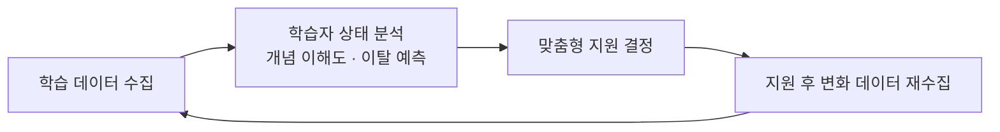

## 1. 지능형 학습 지원 시스템(ITS)의 이해

AI와 학습 데이터를 활용해 학습자에게 최적의 교육적 지원을 제공하는 시스템입니다.

- **작동 원리**: 학습자의 행동 데이터를 수집하고, 현재 위치와 학습 시간 등을 분석해 필요한 지원을 결정합니다.
- **설계 시 고려사항**: 학습자의 상태, 필요, 그리고 최적의 지원 방식을 염두에 두어야 합니다.

**네 가지 핵심 구성 요소**

| 요소 | 역할 |
|---|---|
| **도메인 모델** | 가르칠 지식의 내용과 구조를 정의 |
| **학습자 모델** | 학습자의 상태(지식 수준, 오개념 등)를 분석·추적 |
| **교수 모델** | 학습자 모델의 분석 결과를 바탕으로 어떤 지원(힌트·피드백·격려)을 줄지 결정 |
| **상호작용 인터페이스** | 학습자와 시스템이 만나는 화면 |

> 지능형 학습 지원은 단순히 AI가 답을 알려주는 것이 아니라, **학습자 모델과 교수 모델을 통해 학습자 상태를 해석하고 그에 맞는 개입을 설계하는 것**입니다.

## 2. AI가 가져온 학습 환경의 변화

- **학습 환경의 확장**: 정보량이 폭발적으로 증가했고, 온라인 강의로 학습의 장소와 범위가 무한히 넓어졌습니다.
- **필요 역량의 변화**: 정보를 **암기**하는 능력에서, 수많은 정보 속에서 **진짜와 가짜를 구별**하는 능력으로 이동했습니다.
- **정보 출처의 다변화**: 교사·부모 외에 온라인 커뮤니티, 해외 전문가 등 다양한 출처를 접하게 되었습니다.
- **학습자 다양성 증가**: 온오프라인 연계 학습이 보편화되며 지식 수준·속도·관심사의 편차가 커졌습니다.

## 3. 교육 패러다임의 4가지 전환

| | 이전 | 이후 |
|---|---|---|
| 1 | 표준화 | **개인화** |
| 2 | 결과 평가 | **과정 평가** |
| 3 | 사후 지원 | **실시간 지원** |
| 4 | 지식 전달 | **학습 과정 전체 지원** |

- **표준화 → 개인화**: 모든 학생이 같은 교과서와 속도로 배우던 방식에서 벗어납니다.
- **결과 → 과정 평가**: 중간/기말고사 중심에서, 학습 과정에서 발생하는 데이터(접속 빈도, 문제 풀이 횟수 등)를 함께 봅니다.
- **사후 → 실시간 지원**: 시험 결과가 나온 뒤 부진 학생을 지도하는 대신, 어려움을 겪는 **시점**을 실시간으로 포착합니다.
- **지식 전달 → 학습 과정 지원**: "무엇을 가르쳤는가"에서 **"학습자가 무엇을 어떻게 이해했는가"**로 초점이 이동합니다.

## 4. 교수자와 학습자의 역할 변화

**교수자**

- 단순 지식 전달자에서 **교육 설계자·동기 부여자·코치**로 확장
- AI가 제공하는 분석 결과를 **비판적으로 검토**할 책임 — 데이터의 적절성, 추천의 타당성, 교육 목표 부합성, 윤리적 문제를 판단
- AI 문해력, 데이터 활용 능력, AI 윤리라는 새로운 역량 요구

**학습자**

- 수동적 콘텐츠 수용자에서 **자신의 학습을 주도하고 AI의 도움을 조절하는 주체**로
- AI에게 명확한 질문을 던지고, 정보의 정확성과 편향을 검증하며, **의존도를 스스로 조절**
- 개인정보·저작권·사실 확인 등 책임감 있는 사용 원칙 인지

## 5. AIED와 에듀테크의 차이

| | **AIED** (AI in Education) | **에듀테크** (EdTech) |
|---|---|---|
| 정의 | AI 기술로 교수-학습을 이해·지원·개선하는 **연구 분야** | 교수·학습·운영을 지원하는 **모든 기술과 서비스** |
| 범위 | 좁음 (AI·데이터 중심) | 넓음 (AIED를 포함) |
| 질문 | "AI로 학습을 어떻게 **이해**할까" | "기술로 교육을 어떻게 **개선**할까" |
| 예시 | 학습자 진단, 오류 패턴 발견 | LMS, 온라인 강의 플랫폼, VR/AR, AI 튜터 |

AIED의 핵심은 **"학습이 어떻게 일어나는가"에 대한 교육학·심리학 이론을 AI 기술과 연결하는 것**입니다. 기술만 도입하고 교육 목표와 학습 과정에 대한 고민이 없으면, 기존 행동을 자동화하는 데 그칩니다.

## 6. 개인화 학습 — 강점과 한계

**작동 원리**

| 강점 | 한계 |
|---|---|
| 사전 지식을 반영한 맞춤형 출발점 | **데이터의 불완전성** — 수집된 데이터가 학습자를 다 대변하지 못함 |
| 어려워하는 부분의 조기 발견과 집중 지원 | **미래 가능성 제한** — 과거 데이터 기반 추천이 쉬운 문제만 풀게 하거나 새 분야를 접할 기회를 줄임 |
| 즉각적 피드백으로 학습 효율 상승 | **자율성·상호작용 약화** — 학습 계획을 AI에 의존하게 되고 혼자 학습하는 시간이 늘어남 |

## 7. 효과적인 개인화 학습의 요건

1. **명확한 목표 기반** — 모든 개인화 경로가 공통의 교육 목표를 향할 것
2. **현재 상태 반영** — 과거 데이터뿐 아니라 현재의 상태와 의지를 반영할 것
3. **동등한 학습 기회 보장**
4. **선택권과 통제권 부여** — 추천을 수락하거나 거부할 권한
5. **투명성 확보** — 왜 이 콘텐츠가 추천되었는지 설명할 것
6. **교수자의 개입 보장** — 교수자가 AI 추천을 검토·수정할 수 있을 것

## 8. 장점과 우려점

**장점**

- **학습자**: 시공간 제약 없는 학습, 개인 수준에 맞는 피드백
- **교수자**: 채점·자료 제작 등 반복 업무 경감 → 학생과의 상호작용에 집중
- **교육기관**: 데이터 기반 정책 수립과 학습자 지원 서비스 개발

**우려점**

| 우려 | 내용 |
|---|---|
| 정보의 질 | 생성형 AI의 환각, 편향, 부정확한 정보 |
| 개인정보·프라이버시 | 방대한 학습 데이터의 유출·오남용 위험 |
| 투명성 부족 | 알고리즘 작동 방식을 알 수 없는 '블랙박스' 문제 |
| 디지털 격차 | 기기·네트워크 접근성, 디지털 문해력 차이가 교육 불평등 심화 |
| 사고 과정 생략 | 과도한 의존으로 스스로 생각하는 능력 저하 |
| 저작권·책임 소재 | AI 생성 콘텐츠의 저작권, 교육적 결과의 책임 주체 모호 |

## 9. 인간 중심 AI 교육의 6가지 원칙

1. **AI는 교육 목적 달성을 위한 수단** — 도구이며, 교육의 본질적 목표가 항상 우선
2. **학습자의 사고를 대신하지 않도록 설계** — 생각하는 과정을 생략시키지 말 것
3. **최종 책임은 인간에게** — AI의 결정과 결과에 대한 교육적 책임은 교수자·기관에 있음
4. **모든 학습자에게 공평한 혜택**
5. **투명한 데이터 활용** — 수집·활용 전 과정을 공개하고 동의를 얻을 것
6. **지속적인 효과성 평가** — 실제로 학습에 긍정적 영향을 주는지 계속 검증

---

## Related Notes

- [이러닝의 정의, 역사, 구성 요소](elearning-overview.md)
- [AI EdTech](index.md)
