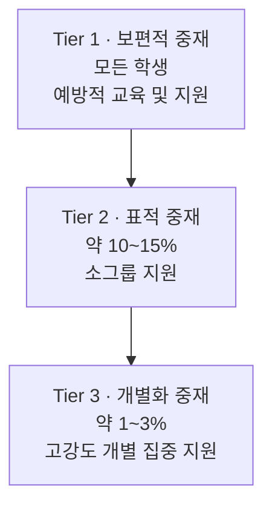

**긍정적 행동지원**(Positive Behavior Support, **PBS**)은 한마디로 정의하기 어려울 만큼 다루는 범위가 넓습니다. 이 글은 PBS가 어디서 출발해 **PBIS**를 거쳐 **MTSS**로 이어졌는지, 그 흐름을 정리합니다.

## 1. 한국에서 PBS가 주목받게 된 배경

- **코로나19 이후 학교 적응 문제**: 비대면 기간을 거치며 학교라는 환경에 적응하는 과정 자체가 어려워진 학생들이 늘었습니다.
- **특수교육대상자 증가**: ADHD나 자폐성 장애 진단을 받는 학생 비율이 늘어, 한 학급에 여러 명의 정서행동 지원 대상 학생이 있는 상황이 생겼습니다.
- **정책적 확대**: 이전까지 특수학교 중심으로 진행되던 PBS를 **2024년부터 일반 학교에도 적용**하는 방향으로 확대되었습니다.

## 2. 미국 특수교육의 역사와 IDEA

PBS의 뿌리는 미국 특수교육의 법적 흐름에 있습니다.

- **1970년대 이전**: 중증 장애 학생을 별도 시설에 분리했습니다. **1970년** 미국 교육부 자료 기준으로, 장애 아동 **다섯 명 중 한 명**만이 학교 교육을 받았고 **100만 명 이상**이 교육에서 배제되어 있었습니다.
- **1975년**: **전 장애 아동교육법**(Education for All Handicapped Children Act) 제정.
- **1990년**: 약 20년의 논의를 거쳐 **IDEA**(Individuals with Disabilities Education Act)로 명칭 변경.

> **'아동들(Children)'에서 '개인들(Individuals)'로** 용어가 바뀐 것은 집단이 아닌 **개개인의 특성과 권리를 존중**하는 철학적 전환을 의미합니다.

### IDEA의 두 핵심 원칙

| 원칙 | 내용 |
|---|---|
| **FAPE** (무상 적정 공교육) | 장애 학생이 비용 부담 없이 **'의미 있는 교육적 혜택'** 을 받을 권리. 이를 위해 개별화 교육 계획(**IEP**)이 필수 |
| **LRE** (최소 제한 환경) | 장애가 있다는 이유만으로 분리된 환경에 배치해서는 안 되며, **먼저 일반 교육 환경에서 지원을 제공**해야 한다는 원칙 |

## 3. 배치 판단과 지능 평가의 이해

LRE 원칙을 적용할 때 '지능'이 배치의 중요한 변수가 됩니다.

- 장애 스펙트럼이 있더라도 지능이 평균 범위(**IQ 80~110**)에 속하면 **일반 학급 통합이 원칙**입니다. 어떤 환경이 사회적·학업적 성취에 더 도움이 되는지를 근거에 따라 판단해야 합니다.
- **웩슬러 지능 검사**는 평균 IQ를 **100**으로 설정하고 2~3년마다 기준을 재조정하며, 검사에 1.5~2시간이 걸립니다. 상위 3%는 **IQ 130**부터이고, 측정 가능한 최대치는 150~160선입니다.
- 미디어에 나오는 매우 높은 IQ(140·150)는 **집단 검사나 레이븐(Raven) 검사** 결과일 가능성이 높고, 웩슬러 검사보다 점수가 과장될 수 있습니다. 과거 집단 검사 결과는 **15~20점 낮춰서** 보는 편이 적절합니다.
- **경계성 지능**은 IQ 70 언저리에 해당하며, '장애'가 아닌데도 '경계성 지능 장애'처럼 잘못 불리는 경우가 많습니다.

공식 진단은 중요하지만 비용과 시간 때문에 모든 학생에게 적용하기 어렵습니다. 교사가 아이의 행동을 관찰하며 얻는 직관을 신뢰하고 유연하게 개입하는 것도 실질적인 방법입니다.

## 4. 행동을 '사인'으로 이해하기

- 수업 중 나타나는 부적응 행동(종이를 오리거나 소리를 내는 등)은 **수업 방해가 아니라 그럴 수밖에 없는 상황에서 보내는 '사인'** 으로 이해해야 합니다.
- 자폐 아동에게 가장 중요한 키워드는 **'적응'** 입니다. 새로운 환경에 적응하는 일이 일반적인 경우보다 비교할 수 없을 만큼 힘듭니다.
- 발달장애 지원에서는 행동을 하나하나 가르치는 것도 중요하지만, **그것을 실행하려는 교사의 마음가짐이 선행**되어야 합니다. 방법을 알아도 실천하고 싶지 않으면 소용이 없습니다.
- 따라서 '어떻게(How To)'보다 먼저, **개입하고 싶게 만드는 이해의 토대**를 세우는 것이 중요합니다. 타인에 대한 이해도가 높아지면 불안감이 줄고 '그러려니' 하는 여유가 생기며, 이것이 행동 중심 접근의 첫걸음이 됩니다.

## 5. '형태'에서 '기능'으로 — PBS의 핵심 전환

문제 행동을 보는 관점이 **'무엇을 했는가'에서 '왜 했는가'로** 전환된 것이 PBS 발전의 핵심입니다.

- **ABA의 기여와 한계**: 응용 행동 분석(**ABA**)은 강화·소거·벌을 통해 행동을 변화시키는 과학적 근거를 마련했지만, 1980년대에는 전기 충격 같은 **비윤리적 혐오 자극**을 사용하기도 했습니다. PBS는 이와 선을 긋고 **'사람 중심 가치'** 를 통합하려는 시도에서 출발했습니다.
- **형태 vs 기능**: 똑같은 자해 행위라도 동기는 관심 끌기, 과제 회피, 자기 자극 추구 등으로 다를 수 있습니다. 중요한 것은 행동의 **모양(형태)** 이 아니라 이면의 **동기(기능)** 입니다.
- **기능 행동 평가**(Functional Behavior Assessment): "왜 그 행동을 했는가?"를 물어 처벌이 아닌 근본 원인에 접근합니다. 지각하는 학생에게 벌을 주는 대신, 원인이 ADHD로 인한 시간 관리의 어려움일 수 있음을 파악하고 **시간 관리 교육을 제공**하는 방식입니다.

질문을 바꾸는 것만으로 문제 해결의 수준이 완전히 달라집니다.

## 6. 학교 차원으로의 확장 — PBIS와 3단계 모델

개별 학생 지원(PBS)은 학교 전체를 대상으로 하는 **예방적 시스템(PBIS)** 으로 확장되었습니다.

- **배경**: 한 명의 학생을 중재해도 학급 전체의 역동성 때문에 효과가 미미한 경우가 많았습니다. 반면 학급 전체, 나아가 학교 전체를 대상으로 예방적으로 접근하자 **문제 행동 발생률이 현저히 감소**했습니다.
- **결정적 계기**: **1997년** 미국 연방법(IDEA)에 PBIS가 명시되었습니다. 법률에 따라 예산이 투입되면서 교육계 전반으로 급속히 확산되었습니다.



학교 교육의 목표는 **학업적 성취와 사회적 성취**입니다. 문제 행동이 중재 대상이 되는 이유는 이 두 목표를 심각하게 저해하기 때문이고, PBS는 **학생의 인격을 존중하면서** 이 목표를 달성하려는 접근입니다.

## 7. MTSS — 행동과 학업의 통합

- **기존 학습장애 판별의 문제**: 과거에는 학생이 **1년** 동안 시험에서 실패하기를 기다렸다가 지능과 학업 성취도의 격차를 확인해 진단하는 **'실패를 기다리는 모델'**(failure-waiting model)을 썼습니다. 비윤리적이라는 비판을 받았습니다.
- **RTI의 등장**: 대안으로 모든 학생에게 양질의 보편적 교육(Tier 1)을 제공하고, 반응이 느린 학생을 **조기에 선별해** 소그룹 심화 지도(Tier 2)를 제공하는 **RTI**(Response to Intervention)가 등장했습니다.
- **MTSS로의 통합**: 학업 지원 체계인 **RTI**와 행동 지원 체계인 **PBIS**를 별개 팀으로 운영하는 비효율이 발생했습니다. 구조적으로 동일한 두 체계를 하나로 합친 것이 **MTSS**(Multi-Tiered System of Supports, 다층 지원 체계)입니다.

```
PBS  →  PBIS  →  MTSS
개별    학교 차원   행동 + 학업 통합
```

이 역사적 흐름과 개념 간 관계를 이해하는 것이 관련 논문을 정확히 해석하는 데 중요합니다.

---

## Related Notes

- [AI 시대의 교육 패러다임 변화와 인간 중심 AI 교육 원칙](ai-education-paradigm.md)
- [AI EdTech](index.md)
