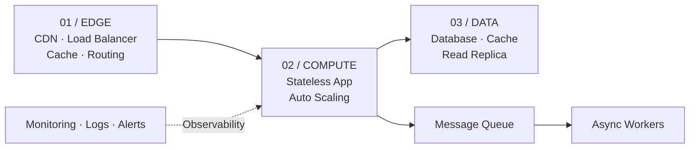

##### Cloud · Architecture · Scalability 

트래픽이 늘어나도 안정적으로 동작하는 서비스를 만들기 위해, 고려해야 할 클라우드 아키텍처 설계 원칙과 단계별 확장 전략

---


처음부터 대규모 트래픽을 가정하고 복잡한 구조를 만들면 개발 속도와 운영 비용이 함께 늘어납니다. 반대로 확장을 전혀 고려하지 않으면 사용자가 늘어나는 순간 구조 전체를 다시 만들어야 합니다. 중요한 것은 지금 필요한 만큼 단순하게 만들되, 나중에 쉽게 나눌 수 있는 경계를 미리 그어 두는 것입니다.

> 클라우드에서 확장 가능한 아키텍처를 설계할 때 가장 중요한 질문은 "처음부터 얼마나 크게 만들 것인가?"보다 "어디가 먼저 한계에 부딪힐 것인가?"입니다.

---

## 목차

1. [문제 정의](#01-문제-정의)
2. [아키텍처 설계](#02-아키텍처-설계)
3. [구현 접근](#03-구현-접근)
4. [주요 설계 결정](#04-주요-설계-결정)
5. [배운 점](#05-배운-점)

## 01. 문제 정의

"확장성"은 단순히 서버를 늘리는 일이 아닙니다. 트래픽, 데이터, 팀 규모가 커질 때 각각 다른 지점에서 병목이 생기기 때문에, 무엇을 확장해야 하는지부터 구분했습니다.

- **트래픽:** 동시 요청이 늘어날 때 어느 계층이 먼저 느려지는가?
- **데이터:** 데이터가 쌓일수록 조회와 저장 비용은 어떻게 변하는가?
- **장애:** 한 구성 요소가 멈추면 서비스 전체가 멈추는가?
- **비용:** 사용량이 줄어드는 시간에도 같은 비용을 내고 있는가?

## 02. 아키텍처 설계

애플리케이션 서버는 상태를 갖지 않도록(stateless) 만들고, 상태는 데이터베이스, 캐시, 스토리지 같은 관리형 서비스에 맡기는 구조를 가정했습니다. 오래 걸리는 작업은 요청 흐름에서 분리해 메시지 큐로 비동기 처리합니다.



*Fig. 002 / Scalable Cloud Architecture*

이 구조에서는 애플리케이션 서버를 몇 대로 늘리거나 줄여도 결과가 같습니다. 사용자 세션이나 업로드 파일이 특정 서버에 묶이지 않기 때문에, 트래픽에 따라 서버 수를 자동으로 조절할 수 있습니다.

## 03. 구현 접근

아래 코드는 실제 프로덕션 코드가 아닌, 오래 걸리는 작업을 요청 흐름에서 분리하는 방식을 보여주는 Python 예시입니다.

```python
# order_service.py (example)
async def create_order(request):
    order = await db.orders.insert(request.items, status="pending")

    # 결제 확인, 알림 발송처럼 오래 걸리는 작업은 큐로 넘깁니다.
    await queue.publish("order.created", {"order_id": order.id})

    return {"order_id": order.id, "status": "pending"}


async def handle_order_created(message):
    order = await db.orders.get(message["order_id"])
    await payment.confirm(order)
    await notification.send(order.user_id, "주문이 완료되었습니다.")
    await db.orders.update(order.id, status="completed")
```

실제 구현에서는 메시지 중복 처리(멱등성), 재시도와 실패 메시지 보관(dead-letter queue), 작업 순서 보장, 큐 적체 모니터링 등을 추가로 고려해야 합니다.

## 04. 주요 설계 결정

| 결정 | 내용 |
|---|---|
| **Stateless First** | 애플리케이션 서버에는 상태를 두지 않고, 세션과 파일은 외부 저장소에 보관합니다. |
| **Async by Default** | 사용자가 즉시 결과를 볼 필요가 없는 작업은 큐를 거쳐 비동기로 처리합니다. |
| **Managed Services** | 데이터베이스, 큐, 캐시는 직접 운영하기보다 관리형 서비스를 우선 검토합니다. |
| **Observability** | 서버 수가 아니라 응답 시간, 오류율, 큐 적체량을 기준으로 확장 시점을 판단합니다. |

## 05. 배운 점

확장 가능한 아키텍처는 처음부터 복잡한 아키텍처가 아닙니다. 단순한 구조로 시작하되, 상태와 비동기 작업을 분리해 두면 필요한 부분만 골라서 확장할 수 있습니다.

결국 클라우드 아키텍처의 설계는 인프라의 문제인 동시에 비용, 장애 대응, 팀의 운영 역량을 함께 고려하는 문제입니다.

---

## Related Notes

- [AI Agent를 실제 서비스에 적용하며 고민한 것들](ai-agent-service.md)
- [데이터 파이프라인을 설계하는 방법](data-pipeline.md)