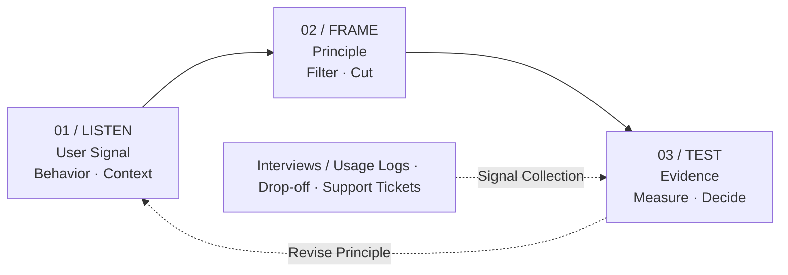

##### Product · MVP · Prototype

기능 목록이 아니라 사용자에 대한 원칙을 기준으로, 무엇을 만들고 무엇을 만들지 않을지 판단한 과정.

---

아이디어가 떠오른 순간에는 대부분 이미 완성된 제품의 모습이 그려지는데요. 문제는 그 그림이 "사람들이 이걸 원할 것이다"라는 검증되지 않은 가정 위에 서 있다는 점입니다. 그래서 기능 목록을 정리하기 전에, 사용자를 어떻게 대할 것인지에 대한 원칙을 먼저 세웠습니다.

>  제품 초기에 던져야 할 질문은 "무엇을 만들까?"보다 **"사용자가 이걸 쓰지 않는다면, 그 이유를 어디서 가장 먼저 발견할 수 있을까?"** 입니다.

## 01. 왜 원칙이 먼저인가

기능 단위로 논의하면 판단 기준이 매번 바뀝니다. 어떤 날은 개발 비용이, 어떤 날은 경쟁 제품이 기준이 되고, 결국 가장 목소리가 큰 사람의 의견이 남습니다. 반대로 사용자에 대한 원칙을 먼저 고정해두면, 개별 기능은 그 기준에 비추어 기계적으로 걸러낼 수 있습니다.

출발점은 우리가 틀릴 가능성이 높다는 사실을 인정하는 것이었습니다. Marty Cagan은 제품 아이디어의 **최소 절반은 작동하지 않으며**, 좋은 팀일수록 자기 아이디어의 3/4은 기대대로 되지 않을 거라고 가정한다고 말합니다. 실패하는 가장 흔한 이유도 기술적 한계가 아니라, 고객이 팀만큼 그 아이디어에 흥분하지 않기 때문입니다.

실제 측정치도 비슷합니다. Microsoft의 온라인 실험 플랫폼을 이끌었던 Ron Kohavi의 보고에 따르면, 의도한 지표를 실제로 개선한 아이디어는 **약 1/3에 불과**했고 나머지 1/3은 변화가 없었으며 1/3은 오히려 지표를 악화시켰습니다. Bing처럼 이미 최적화가 많이 진행된 영역에서는 성공률이 10~20% 수준까지 떨어집니다.

## 02. 네 가지 사용자 원칙

그래서 아래 네 가지를 판단 기준으로 고정했습니다. 모든 범위 결정은 이 원칙에 비추어 설명할 수 있어야 했습니다.

- **진전 우선:** 사용자는 기능을 원하는 게 아니라, 자기 상황에서의 진전을 원한다.
- **행동 우선:** "쓸 것 같다"는 말이 아니라 실제로 한 행동만 신호로 센다.
- **확신 불신:** 팀의 확신은 증거가 아니다. 확신이 클수록 먼저 검증한다.
- **되돌릴 여지:** 사용자가 잘못 눌러도 손해 보지 않게, 되돌릴 수 있게 만든다.



*Fig. 001 / Principle-Driven Product Loop*

중요한 건 원칙이 고정된 교리가 아니라는 점입니다. 사용자 신호가 원칙과 어긋나면 기능이 아니라 **원칙을 수정**합니다. 다이어그램의 되돌아가는 점선이 그 경로입니다.

## 03. 원칙을 범위 결정으로 옮기기

아래는 실제 제품 코드가 아닌, 원칙을 범위 판단에 적용하는 흐름을 보여주는 Python 예시입니다.

```python
# scope.py (example)
def should_build(feature, user_signal):
    # 원칙 1: 기능이 아니라 사용자의 진전에 기여하는가
    if not feature.advances_user_job:
        return False, "사용자의 진전과 무관함"

    # 원칙 2: 근거가 말인가 행동인가
    if user_signal.kind == "stated_preference":
        return False, "행동 신호로 다시 확인 필요"

    # 원칙 3: 확신이 클수록 먼저, 싸게 검증한다
    if feature.team_confidence > HIGH and feature.evidence < MIN:
        return False, "확신만 있고 증거가 없음"

    return True, "가장 위험한 가정을 직접 검증함"
```

세 번째 조건이 실제로 가장 자주 걸렸습니다. 팀이 확신하는 기능일수록 검증을 건너뛰려는 압력이 커지는데, 앞서 본 수치를 생각하면 그때가 오히려 가장 위험한 순간이었습니다.

## 04. 원칙별 검증 방법과 근거

| 원칙 | 검증 방법 | 근거 |
|---|---|---|
| **진전 우선** | 현재 대안(수작업·스프레드시트)을 먼저 관찰하고, 제품이 그보다 나은 지점을 특정합니다. | 실패의 주된 이유는 기술이 아니라 "고객이 팀만큼 그 아이디어에 흥분하지 않는 것" (Cagan) |
| **행동 우선** | 설문 응답 대신 실제 사용·이탈 로그를 신호로 봅니다. | 지표를 실제로 개선한 아이디어는 약 1/3 (Kohavi, Microsoft) |
| **확신 불신** | 만들기 전에 성공·실패 기준선을 숫자로 먼저 정합니다. | 좋은 팀일수록 아이디어의 3/4이 실패한다고 가정 (Cagan) |
| **되돌릴 여지** | 소수 사용자 대상 반복 테스트로 막히는 지점을 먼저 찾습니다. | 사용자 5명으로 사용성 문제의 약 85% 발견 (Nielsen & Landauer, 1993) |

마지막 항목은 자주 오해되는 수치라 덧붙입니다. Nielsen의 조언은 "5명 테스트하고 끝내라"가 **아니라**, 예산을 작은 라운드로 쪼개 최소 3회 이상 반복하라는 쪽이었습니다. 85%라는 숫자도 각 문제의 발견 확률이 31% 정도일 때 성립하는 모델값이라, 일부 사용자만 겪는 미묘한 문제는 5명으로 놓치기 쉽습니다.

## 05. 배운 점

처음 세운 가정 중 상당수는 틀렸지만, 틀렸다는 사실을 일찍 알게 된 것 자체가 가장 큰 수확이었습니다. 원칙을 먼저 세운 덕분에 "이 기능을 왜 빼는가"를 매번 새로 논쟁하지 않아도 됐습니다.

제품을 만드는 과정은 아이디어를 구현하는 일이라기보다, 사용자 신호에 비추어 틀린 부분을 계속 걷어내는 일에 가까웠습니다. 결국 좋은 제품은 많이 만든 결과가 아니라, 무엇을 만들지 않을지 잘 판단한 결과로 남습니다.

---

## 참고 자료

- Marty Cagan, *INSPIRED: How to Create Tech Products Customers Love* — [Mind the Product 강연 정리](https://www.mindtheproduct.com/learnings-from-london-marty-cagan-on-making-products-customers-love/)
- Ron Kohavi et al., *Online Experimentation at Microsoft* (2009) — [논문 PDF](https://ai.stanford.edu/~ronnyk/ExPThinkWeek2009Public.pdf)
- Jakob Nielsen, *Why You Only Need to Test with 5 Users* — [NN/g](https://www.nngroup.com/articles/why-you-only-need-to-test-with-5-users/)

## Related Notes

- [기술을 배우는 방식에 대한 새로운 생각](learning-technology.md)
- [AI Agent를 실제 서비스에 적용하며 고민한 것들](ai-agent-service.md)
